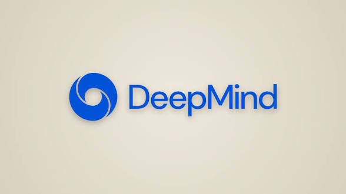

  

<h1 align="center">👋 Kimi</h1>

  <b>15 y.o. · coding since 10</b> 
  🇷🇺 Russia · 🎯 <b>Google DeepMind</b>

  
  

---

## 🏎️ About Me

I'm a self-taught developer who started coding at 10. By 15, I've built projects for thousands of users, led a dev team, and I'm now aiming for **Google DeepMind**.

But there's one thing that drives me more than code — **motorsport**.

I'm a long-time Formula 1 fan. **Mercedes** is my team. **"Rush"** (2013) and **"Ford v Ferrari"** are my favorite films. **Interstellar** — because I believe the future is built by those who dream big.

I build things for fans. Because when you build for people who truly care — you build with purpose.

> *"I don't just write code. I build tools for people who live for the speed."*

---

## 🧠 Tech Stack

  

| Area | Technologies |
|------|--------------|
| **Primary** | Python · Java · JavaScript |
| **Learning** | Go · C++ |
| **DevOps** | Docker · Kubernetes · Linux · GitHub Actions |
| **Frontend** | HTML · CSS |

---

## 🚀 My Projects

| Project | Description |
|---------|-------------|
| **Liberty Formula** | Free F1 streaming site for fans who can't afford subscriptions |
| **INDY Leader** | Telegram bot for IndyCar fans — for beginners and casual viewers |

> I build for the community. Every project starts with a question: *"What would make this better for the fans?"*

---

## 🎯 2026 Focus

- Mastering **Go** — microservices, CLIs, Kubernetes operators
- Building **production-grade** projects
- Open-source contributions
- Preparing for **Google DeepMind**

---

## 🌐 Community

| | |
|---|---|
| **Team** | [P4/9 Team](https://github.com/RedRaceTeam) |
| **Telegram** | [P4Devl](https://t.me/P4Devl) |

---

## 📫 Connect

  
  
  

---

  <i>"I don't just write code. I build tools for people who live for the speed."</i> 
  <b>— Kimi</b>

 
